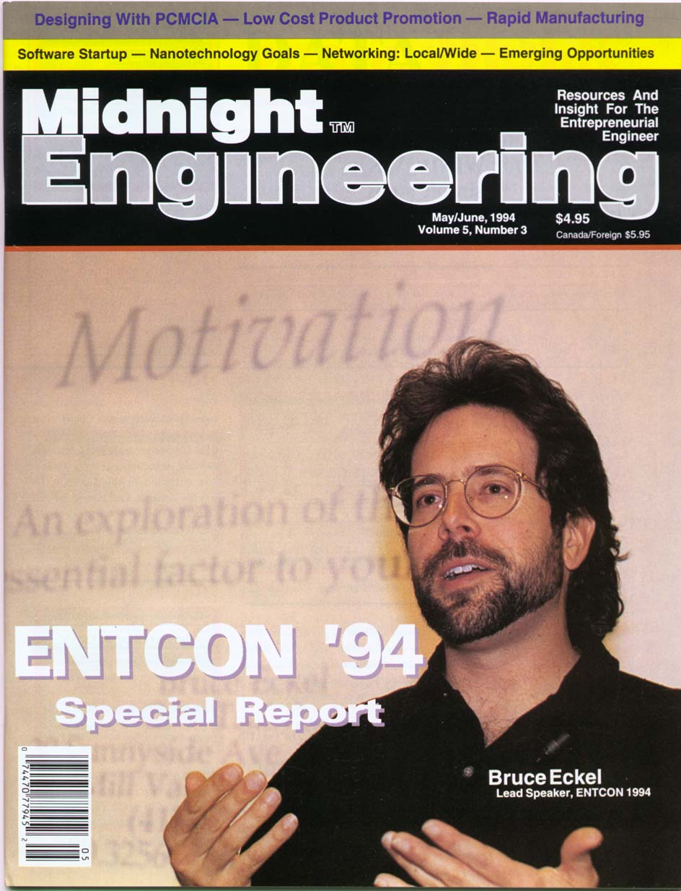
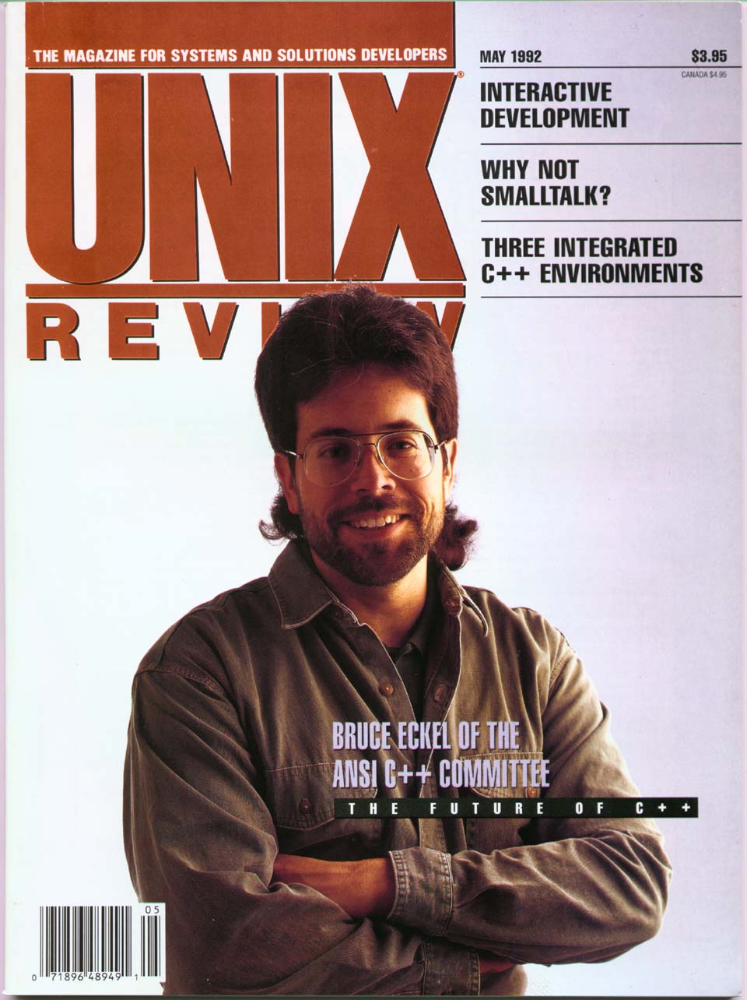

- Questions? Email MindView: <button type="button" class="email-button" data-to="mindview">Show email address</button><noscript> (Enable JavaScript to see the email address.)</noscript>
- [IRS Form W-9](W9.pdf)

## Biography

<!-- include: bio.md -->

## Wikipedia Entry

- [Bruce Eckel](https://en.wikipedia.org/wiki/Bruce_Eckel)

## Publicity Photo

<figure class="photo">

<figcaption><a href="/publicity/BruceEckel.jpg" download>Download the full-size photo</a></figcaption>
</figure>

## Covers

Two magazine covers from the past.

+ Site built from Markdown by a
<a href="https://github.com/BruceEckel/MindviewLLC-site" target="_blank">Python script</a>.

+ Graphics by <a href="http://www.Will-Harris.com">Daniel Will-Harris</a>

